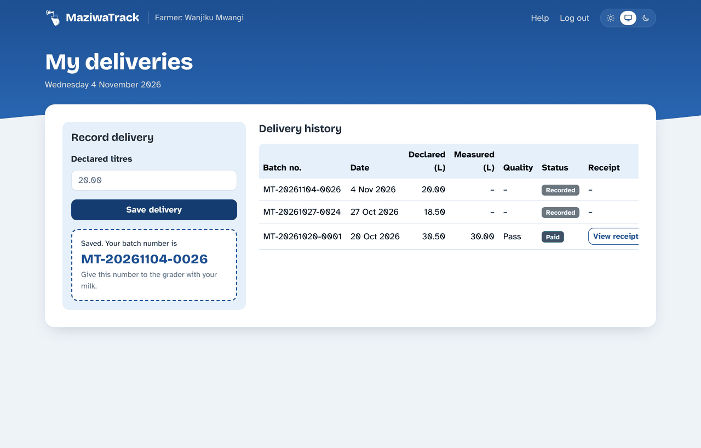
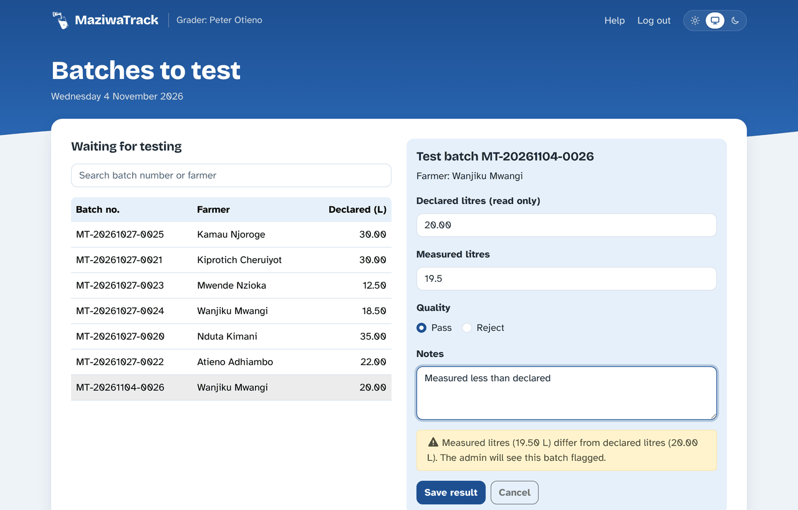
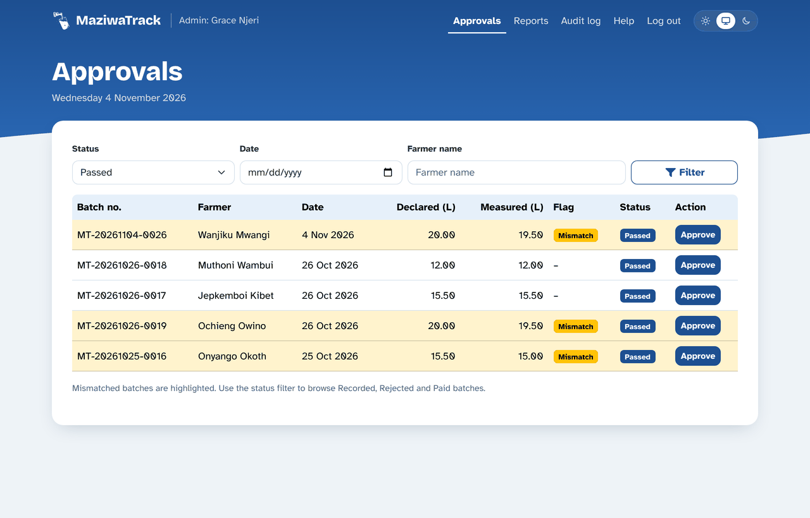
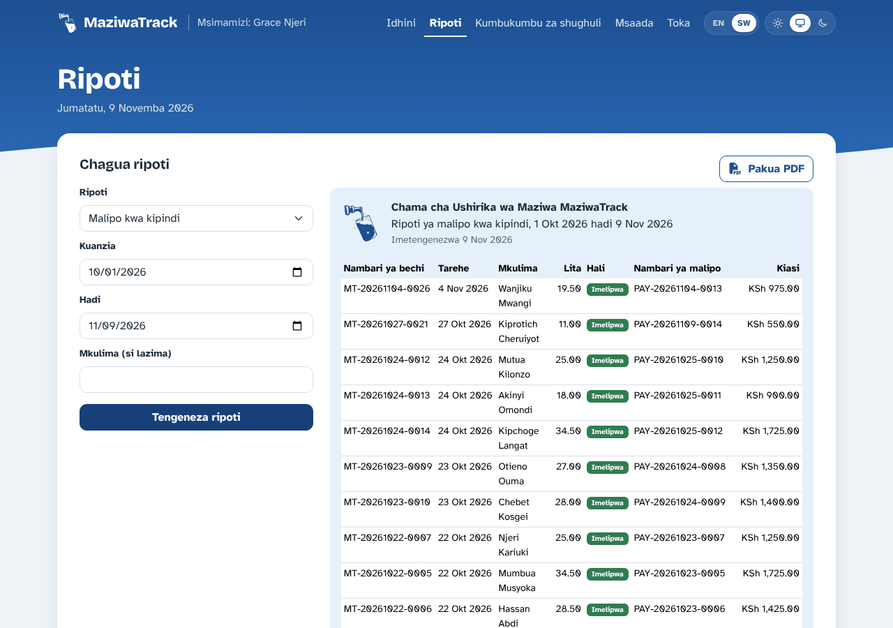

<p align="center">
  <picture>
    <source media="(prefers-color-scheme: dark)" srcset="public/logo-full-dark.svg">
    
  </picture>
</p>

<h1 align="center">MaziwaTrack</h1>

<p align="center">
  A web-based milk collection and payment system for dairy cooperatives.<br>
  Farmers record deliveries, graders test them, and administrators approve payment. Every step is checked and recorded in an audit log.
</p>

---

## Contents

- [Key features](#key-features)
- [Screenshots](#screenshots)
- [Tech stack](#tech-stack)
- [Prerequisites](#prerequisites)
- [Installation and setup](#installation-and-setup)
- [Usage](#usage)
- [Configuration](#configuration)
- [API overview](#api-overview)
- [Project structure](#project-structure)
- [Testing](#testing)
- [Contributing](#contributing)
- [Team](#team)
- [License](#license)

## Key features

**Farmers**
- Register their own account (grader and admin accounts are created by the system administrator).
- Record a milk delivery and receive a unique batch number such as `MT-20261109-0027`.
- Follow each delivery's status (Recorded → Passed / Rejected → Paid) and view or print the payment receipt.

**Graders**
- See the queue of batches waiting to be tested, oldest first, with search by batch number or farmer.
- Enter the measured litres, choose Pass or Reject, and add notes.
- Get a warning when the measured litres differ from what the farmer declared.

**Administrators**
- Review tested batches and see mismatched batches highlighted. Filter by status, date and farmer.
- Approve payment: amount = measured litres × price per litre. A receipt is emailed to the farmer, and can be resent if sending failed.
- Generate four reports: daily collection, payments by date range, farmer statement, and litre mismatches. Each can be saved as a PDF through the browser's print dialog.
- Browse a read-only audit log of every action (who, what, when, old → new values).

**Security and accounts**
- Two-factor login for every user: a 6-digit code is emailed after the password. It is valid for 10 minutes, allows 5 wrong tries, and a new one can be requested after 60 seconds.
- Forgot / reset password by email. Each link works once and expires after 30 minutes.
- bcrypt password hashing, and a JWT session in an `httpOnly` cookie (8 hours).
- Role-based access on every route, `helmet` security headers, rate limits on login and reset requests, and Row Level Security on all tables.

**Interface**
- English / Kiswahili switch, remembered per browser. Dates follow the chosen language.
- Light, dark or "match my device" appearance.
- Responsive layout that works on phones.
- **Sample-data mode:** runs the whole frontend in the browser with no backend or database, for demos and UI testing.

## Screenshots

| Farmer: record a delivery | Grader: test a batch |
|---|---|
|  |  |
| **Admin: approvals** | **Admin: payments report (Kiswahili)** |
|  |  |

## Tech stack

| Layer | Technology |
|---|---|
| Frontend | React 19, Vite 8, React Router 7, Bootstrap 5.3, Font Awesome |
| Translations | i18next + react-i18next (English and Kiswahili) |
| Backend | Node.js, Express 5 (CommonJS) |
| Database | PostgreSQL, hosted on Supabase, accessed with `pg` |
| Auth & security | jsonwebtoken, bcryptjs, cookie-parser, helmet, cors, express-rate-limit |
| Email | Nodemailer over SMTP (Mailtrap for testing, Gmail for demos) |
| Testing | Vitest, React Testing Library, jsdom, supertest |
| Tooling | nodemon, oxlint, dotenv |

Frontend and backend live in one package with a single `.env` file.

## Prerequisites

- **Node.js 20.19 or newer** (check with `node -v`) and npm.
- **A PostgreSQL database.** The project is set up for [Supabase](https://supabase.com); a local PostgreSQL server also works.
- **An SMTP account** for emails (optional for local development; see [Emails without SMTP](#emails-without-smtp)).
- **A second, empty PostgreSQL database** if you want to run the API tests (optional; see [Testing](#testing)).
- Git.

## Installation and setup

### 1. Clone and install

```bash
git clone https://github.com/Cs-Star-Korir/Maziwa_Track_IS.git
cd Maziwa_Track_IS
npm install
```

### 2. Create the `.env` file

Copy the template into the project root (next to `package.json`) and fill it in:

```bash
cp .env.example .env
```

At minimum, set `DATABASE_URL` and `JWT_SECRET`; the server will not start without them. See [Configuration](#configuration) for every setting.

> [!WARNING]
> `.env` is listed in [`.gitignore`](.gitignore). Never commit it or share the database password.

### 3. Create the database tables

Run [`db/schema.sql`](db/schema.sql) once. It creates the six tables (`users`, `batches`, `payments`, `audit_logs`, `password_resets`, `login_codes`) and turns on Row Level Security. It is safe to run again.

- **Supabase:** open your project → **SQL Editor** → paste the file → **Run**.
- **Local PostgreSQL:**
  ```bash
  psql "<your DATABASE_URL>" -f db/schema.sql
  ```

### 4. Load the sample data (optional)

Run the seed files **in this order**, because each needs the rows from the one before:

1. [`db/01_users.sql`](db/01_users.sql): 26 users (1 admin, 2 graders, 23 farmers)
2. [`db/02_batches.sql`](db/02_batches.sql)
3. [`db/03_payments.sql`](db/03_payments.sql)
4. [`db/04_audit_logs.sql`](db/04_audit_logs.sql)

Every seeded account uses the password **`Password123`**. For example:

| Role | Email |
|---|---|
| Admin | `grace.njeri@example.com` |
| Grader | `peter.otieno@example.com` |
| Farmer | `wanjiku.mwangi@example.com` |

### 5. Start the app

Use two terminals:

```bash
# Terminal 1 – API on http://localhost:5000/api (restarts when files in server/ change)
npm run server

# Terminal 2 – frontend on http://localhost:5173
npm run dev
```

Open <http://localhost:5173> and log in. To confirm that the API can reach the database, open <http://localhost:5000/api/health>; it should return `{"status":"ok","database":"up",...}`.

> [!NOTE]
> nodemon watches only the `server/` folder. After editing `.env`, type `rs` and press Enter in the server terminal to restart it.

## Usage

### Available scripts

| Command | What it does |
|---|---|
| `npm run dev` | Starts the Vite dev server for the frontend |
| `npm run server` | Starts the API with nodemon (auto-restart on changes in `server/`) |
| `npm start` | Starts the API with plain Node (no auto-restart) |
| `npm run build` | Builds the frontend into `dist/` |
| `npm run preview` | Serves the built frontend locally |
| `npm run lint` | Runs oxlint |
| `npm test` | Runs every automated test once (see [Testing](#testing)) |
| `npm run test:watch` | Re-runs the tests whenever a file changes |
| `npm run test:unit` / `test:ui` / `test:api` | Runs one group of tests |

### A typical flow

1. **Farmer** logs in, enters the declared litres and saves the delivery, then gives the batch number to the grader with the milk.
2. **Grader** selects the batch, enters the measured litres, chooses Pass or Reject, and saves.
3. **Admin** opens **Approvals**, checks any highlighted mismatch, and clicks **Approve**. The farmer receives the receipt by email and can also open it from their delivery history.
4. **Admin** uses **Reports** to generate and download summaries, and **Audit log** to review activity.

Use the **EN | SW** switch in the top bar to change language, and the sun / screen / moon switch to change appearance.

### Sample-data mode (no backend)

Set `VITE_USE_MOCK=true` in `.env` and run only `npm run dev`. Data is generated from [`src/data/mockData.js`](src/data/mockData.js) and kept in the browser.

| Role | Email | Password |
|---|---|---|
| Admin | `admin@example.com` | `password123` |
| Grader | `grader@example.com` | `password123` |
| Farmer | `wanjiku@example.com` | `password123` |

Click **Reset sample data** on the login page to start over. This mode sends no email, so it skips the login code, and password reset is unavailable.

### Emails without SMTP

If `SMTP_HOST` is empty, emails are printed in the server terminal instead of being sent. That includes 2FA login codes, so you can still log in during local development by copying the code from the terminal.

## Configuration

All settings live in one `.env` file in the project root. Only settings starting with `VITE_` are sent to the browser; everything else stays on the server.

| Variable | Required | Default | Description |
|---|---|---|---|
| `DATABASE_URL` | **Yes** | – | PostgreSQL connection string. For Supabase use the **Session pooler** URI (Connect → Session pooler). SSL is used automatically unless the host is `localhost`. |
| `JWT_SECRET` | **Yes** | – | Long random string used to sign login tokens. |
| `PORT` | No | `5000` | API port. |
| `CLIENT_ORIGIN` | No | `http://localhost:5173` | Frontend address(es) allowed by CORS; comma-separated for more than one. |
| `COOKIE_SECURE` | No | `false` | Set to `true` when the site is served over HTTPS. |
| `PRICE_PER_LITRE` | No | `50` | Price in KSh used to calculate payments. |
| `COOPERATIVE_NAME` | No | `MaziwaTrack Dairy Cooperative` | Name shown in emails. |
| `TIME_ZONE` | No | `Africa/Nairobi` | Time zone for batch-number dates and date filters. Use a named zone, not an offset like `+03:00`. |
| `SMTP_HOST` | No | – | SMTP server. Leave empty to print emails to the terminal. |
| `SMTP_PORT` | No | `587` | SMTP port (`465` switches on implicit TLS). |
| `SMTP_USER` / `SMTP_PASS` | No | – | SMTP login. For Gmail use an App Password. |
| `MAIL_FROM` | No | – | Sender shown on emails, e.g. `MaziwaTrack <no-reply@maziwatrack.co.ke>`. |
| `APP_URL` | No | `http://localhost:5173` | Site address used in password-reset links. Set it to your site's address when deployed. |
| `TEST_DATABASE_URL` | No | – | A **separate, empty** database for the API tests. They delete all its data, so never use the database in `DATABASE_URL`. Leave empty to skip the API tests. |
| `VITE_API_URL` | No | `http://localhost:5000/api` | API address used by the frontend. |
| `VITE_USE_MOCK` | No | sample data on | `false` calls the real API. Any other value, or leaving it out, uses sample data. |

## API overview

All routes are served under `/api` (see [`server/apis.js`](server/apis.js)). Requests and responses are JSON; authentication uses the `httpOnly` cookie set at login.

| Method | Route | Access | Purpose |
|---|---|---|---|
| GET | `/health` | Public | Server and database status |
| POST | `/auth/register` | Public | Farmer self-registration |
| POST | `/auth/login` | Public | Email + password; emails a login code |
| POST | `/auth/verify-code` | During login | Checks the 6-digit code and starts the session |
| POST | `/auth/resend-code` | During login | Sends a new code |
| POST | `/auth/forgot-password` | Public | Emails a reset link |
| POST | `/auth/reset-password` | Public | Sets a new password with the link's token |
| GET | `/auth/me` | Logged in | Current user |
| POST | `/auth/logout` | Public | Clears the session cookie |
| GET | `/config` | Logged in | Price per litre and cooperative name |
| POST | `/batches` | Farmer | Record a delivery |
| GET | `/batches/mine` | Farmer | Own deliveries |
| GET | `/batches` | Grader, Admin | List and filter batches |
| PATCH | `/batches/:batch_number/verify` | Grader | Save the test result |
| POST | `/payments` | Admin | Approve payment for a passed batch |
| POST | `/payments/:payment_reference/resend` | Admin | Resend the receipt email |
| POST | `/reports/log` | Admin | Record that a report was generated |
| GET | `/audit-logs` | Admin | Read the audit log |

## Project structure

```text
.
├── __tests__/            # automated tests (see Testing)
│   ├── unit/             # logic: formatting, translations, sample data, email, access checks
│   ├── ui/               # React screens in a simulated browser
│   ├── api/              # the Express API against a test database
│   ├── helpers/          # shared test code, including a fake email server
│   └── setup/            # runs before the tests: test settings and database tables
├── db/                   # schema.sql + seed files (01–04), run in Supabase SQL Editor
├── public/               # logos and favicon
├── server/               # Express API
│   ├── index.js          # entry point: loads .env, checks the database, starts the server
│   ├── app.js            # middleware (helmet, CORS, JSON, cookies) and error handling
│   ├── apis.js           # mounts every route under /api
│   ├── db.js             # PostgreSQL pool, transactions, audit helper
│   ├── mail.js           # Nodemailer setup and email layout
│   └── routes/           # auth, batches, payments, reports, audit, config, health
├── src/                  # React frontend
│   ├── components/       # layout, navbar, language and theme switches, modal…
│   ├── context/          # AuthContext (current user, login, logout)
│   ├── data/             # sample data for sample-data mode
│   ├── i18n/             # en.json, sw.json and i18next setup
│   ├── pages/            # login/register/help, farmer/, grader/, admin/
│   ├── services/         # api.js (real API) and mockApi.js (sample data)
│   ├── styles/           # main.css
│   └── utils/            # number and date formatting
├── Diagrams/             # UML, ER, schema, flowchart, wireframes, Gantt chart
├── .env.example          # settings template
├── index.html
├── package.json
├── vite.config.js
└── vitest.config.mjs     # test settings: the unit, ui and api groups
```

## Testing

The automated tests live in [`__tests__/`](__tests__) and run with [Vitest](https://vitest.dev). There are **185 tests** in three groups:

| Group | Folder | Tests | What it checks | Needs |
|---|---|---|---|---|
| `unit` | [`__tests__/unit`](__tests__/unit) | 47 | Number and date formatting, English/Kiswahili files (same keys, same placeholders, every key used on screen exists), translated server messages, sample-data rules, email helpers, role checks | Nothing |
| `ui` | [`__tests__/ui`](__tests__/ui) | 43 | The login (with 2FA code), register, farmer, grader and approvals screens, page access per role, the language and appearance switches. The API is replaced by a fake, so no server is needed. | Nothing |
| `api` | [`__tests__/api`](__tests__/api) | 95 | The real Express API and database: registration, login codes, password reset, deliveries, grading, payments and receipts, reports, the audit log, role restrictions and rate limits | A test database |

### Running the tests

```bash
npm test               # all groups
npm run test:watch     # keeps running and re-tests on every save
npm run test:unit      # one group only (also test:ui and test:api)
npx vitest run __tests__/api/payments.test.js   # one file
```

Without a test database, the `unit` and `ui` groups still run and the `api` group is skipped with a message.

### Setting up the test database (for the `api` group)

The API tests **empty every table** before each test file, so they need their own database. Then add its address to `.env`:

```dotenv
TEST_DATABASE_URL=postgresql://<user>:<password>@localhost:5432/maziwatrack_test
```

- **Local PostgreSQL:** create an empty database, for example with `createdb maziwatrack_test`.
- **Supabase:** create a second, free project just for tests and use its Session pooler address, as for `DATABASE_URL`.

The tables are created automatically from [`db/schema.sql`](db/schema.sql), and every test file starts with the seeded users from [`db/01_users.sql`](db/01_users.sql). Two safety checks stop the tests from touching real data:
- they refuse to run if `TEST_DATABASE_URL` is the same as `DATABASE_URL`;
- they refuse to run if the test database has any user without an `@example.com` email address.

### How the tests work

- **Emails:** the API tests start a small fake email server ([`__tests__/helpers/smtpServer.js`](__tests__/helpers/smtpServer.js)). The app sends to it as it would to Mailtrap or Gmail, so the tests read real login codes, receipts and reset links. They can also make it refuse emails, to check that a payment is still saved when the receipt email fails. No email leaves your computer, and your `SMTP_*` settings are not used.
- **Settings:** tests use fixed settings (a test `JWT_SECRET`, price KSh 50, Nairobi time zone), set in [`__tests__/setup/api.js`](__tests__/setup/api.js). Your `.env` is only read for `TEST_DATABASE_URL`.
- **Test plan IDs:** test names start with the case ID from the end-to-end test plan where one exists (for example `A4`, `P5`, `X8`), so automated results can be matched to the documentation.

### Writing a new test

1. Put it in the matching folder, named `<something>.test.js` (or `.test.jsx` for screens).
2. For API tests, use the helpers in [`__tests__/helpers/api.js`](__tests__/helpers/api.js): `resetDb()`, `loginAs('farmer')`, `recordDelivery()`, `testBatch()`, `lastMailTo()`.
3. For screens, use `renderAt()` and `fakeApi()` from [`__tests__/helpers/ui.jsx`](__tests__/helpers/ui.jsx).
4. Login and reset requests are rate-limited per test file (10 failed logins, 20 code checks, 5 reset requests per 15 minutes). If a file needs more, split it into two files.

### Other checks

- `npm run lint` runs oxlint, and `npm run build` confirms the frontend compiles.
- With the server running, <http://localhost:5000/api/health> should report `"database":"up"`.

## Contributing

1. Create a branch from `main` for each change, for example `feat/kiswahili-translation`.
2. Keep commits focused, with a short prefix describing the change, for example `Feature: English/Kiswahili language toggle`.
3. Before opening a pull request, run `npm run lint`, `npm test` and `npm run build`. Add or update tests for what you changed.
4. Open a pull request into `main` and describe what changed and how you tested it. Another team member reviews it before merging.
5. When adding on-screen text, add the same key to both [`src/i18n/en.json`](src/i18n/en.json) and [`src/i18n/sw.json`](src/i18n/sw.json).
6. Never commit `.env`, database passwords or SMTP credentials.

Report bugs and suggestions through the repository's GitHub **Issues**, with steps to reproduce and a screenshot where possible.

## Team

| Name | Role |
|---|---|
| Jeremy | QA and documentation |
| Tonybrian | Backend |
| Angelo | Frontend |

## License

This project is licensed under the [MIT License](https://opensource.org/licenses/MIT).
