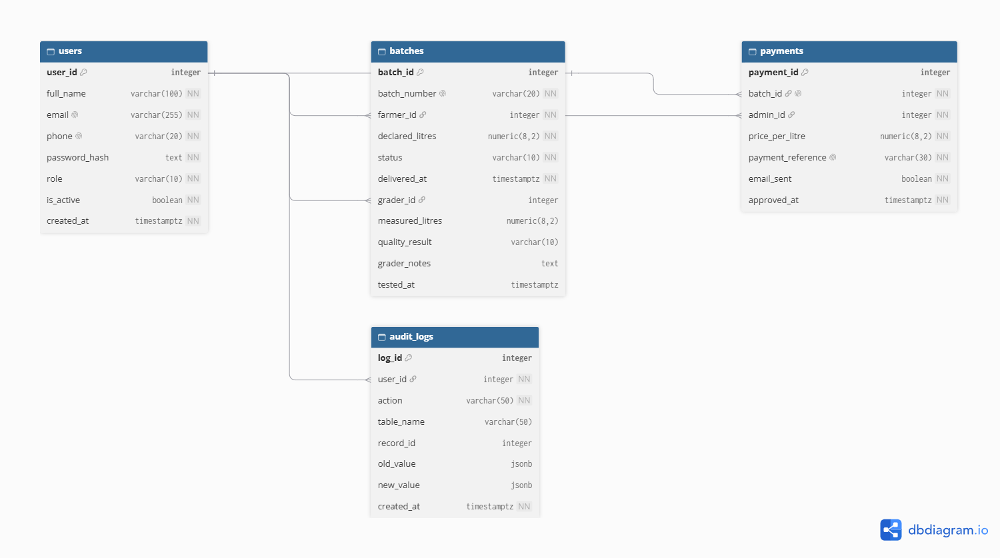

# MaziwaTrack — Database Reference

## Overview

The MaziwaTrack database is **PostgreSQL** hosted on [Supabase](https://supabase.com), organised in the `public` schema. The schema is in **Third Normal Form (3NF)** — no data is duplicated across tables, and every non-key column depends only on its table's primary key.

There are **4 tables**:

| Table | Purpose |
|---|---|
| `users` | Everyone who logs in (farmers, graders, admins) |
| `batches` | Individual milk deliveries |
| `payments` | Payment approvals for passed batches |
| `audit_logs` | Immutable record of every significant action |

Row Level Security (RLS) is **enabled on all tables**. The Supabase REST API cannot read any table directly — all access goes through the Express backend.

---

## Entity Relationship Diagram



---

## Tables

### `users`

Stores every account in the system. Farmers register themselves; grader and admin accounts are created by the system administrator.

| Column | Type | Nullable | Default | Notes |
|---|---|---|---|---|
| `user_id` | `INTEGER` | No | Auto-increment (identity) | Primary key |
| `full_name` | `VARCHAR(100)` | No | — | Display name |
| `email` | `VARCHAR(255)` | No | — | Must be unique |
| `phone` | `VARCHAR(20)` | No | — | Must be unique; Kenyan format |
| `password_hash` | `TEXT` | No | — | bcrypt hash — never the plain password |
| `role` | `VARCHAR(10)` | No | `'farmer'` | One of: `farmer`, `grader`, `admin` |
| `is_active` | `BOOLEAN` | No | `TRUE` | Set to `FALSE` to disable an account |
| `created_at` | `TIMESTAMPTZ` | No | `now()` | Timestamp when account was created |

**Constraints:**

- `pk_users` — PRIMARY KEY (`user_id`)
- `uq_users_email` — UNIQUE (`email`)
- `uq_users_phone` — UNIQUE (`phone`)
- `chk_users_role` — CHECK `role IN ('farmer', 'grader', 'admin')`

---

### `batches`

One row per milk delivery. Grader columns (`grader_id`, `measured_litres`, `quality_result`, `grader_notes`, `tested_at`) are `NULL` until the batch is tested.

| Column | Type | Nullable | Default | Notes |
|---|---|---|---|---|
| `batch_id` | `INTEGER` | No | Auto-increment (identity) | Primary key |
| `batch_number` | `VARCHAR(20)` | No | — | Auto-generated: `MT-YYYYMMDD-NNNN` e.g. `MT-20261113-0007` |
| `farmer_id` | `INTEGER` | No | — | FK → `users.user_id` |
| `declared_litres` | `NUMERIC(8,2)` | No | — | Litres the farmer declared at drop-off |
| `status` | `VARCHAR(10)` | No | `'recorded'` | Lifecycle: `recorded` → `passed`/`rejected` → `paid` |
| `delivered_at` | `TIMESTAMPTZ` | No | `now()` | When the batch was recorded |
| `grader_id` | `INTEGER` | Yes | `NULL` | FK → `users.user_id`; set when tested |
| `measured_litres` | `NUMERIC(8,2)` | Yes | `NULL` | Grader's actual measurement |
| `quality_result` | `VARCHAR(10)` | Yes | `NULL` | Either `pass` or `reject` |
| `grader_notes` | `TEXT` | Yes | `NULL` | Optional notes from grader (max 1000 chars) |
| `tested_at` | `TIMESTAMPTZ` | Yes | `NULL` | When the grader submitted the result |

**Constraints:**

- `pk_batches` — PRIMARY KEY (`batch_id`)
- `uq_batches_number` — UNIQUE (`batch_number`)
- `fk_batches_farmer` — FOREIGN KEY (`farmer_id`) → `users(user_id)`
- `fk_batches_grader` — FOREIGN KEY (`grader_id`) → `users(user_id)`
- `chk_batches_status` — CHECK `status IN ('recorded', 'passed', 'rejected', 'paid')`
- `chk_quality_result` — CHECK `quality_result IS NULL OR quality_result IN ('pass', 'reject')`
- `chk_declared_litres` — CHECK `declared_litres > 0`
- `chk_measured_litres` — CHECK `measured_litres IS NULL OR measured_litres > 0`

---

### `payments`

One row per approved payment. Each passed batch can only be paid once (`uq_payments_batch`). The payment **amount is not stored** — it is always calculated as `measured_litres × price_per_litre` at query time.

| Column | Type | Nullable | Default | Notes |
|---|---|---|---|---|
| `payment_id` | `INTEGER` | No | Auto-increment (identity) | Primary key |
| `batch_id` | `INTEGER` | No | — | FK → `batches.batch_id`; unique (one payment per batch) |
| `admin_id` | `INTEGER` | No | — | FK → `users.user_id`; the admin who approved |
| `price_per_litre` | `NUMERIC(8,2)` | No | — | Price at the time of approval (from `PRICE_PER_LITRE` env var) |
| `payment_reference` | `VARCHAR(30)` | No | — | Auto-generated: `PAY-YYYYMMDD-NNNN` e.g. `PAY-20261113-0007` |
| `email_sent` | `BOOLEAN` | No | `FALSE` | Whether the farmer notification email was sent successfully |
| `approved_at` | `TIMESTAMPTZ` | No | `now()` | When the admin approved the payment |

**Constraints:**

- `pk_payments` — PRIMARY KEY (`payment_id`)
- `uq_payments_batch` — UNIQUE (`batch_id`) — one payment per batch, enforced at DB level
- `uq_payments_reference` — UNIQUE (`payment_reference`)
- `fk_payments_batch` — FOREIGN KEY (`batch_id`) → `batches(batch_id)`
- `fk_payments_admin` — FOREIGN KEY (`admin_id`) → `users(user_id)`
- `chk_price_per_litre` — CHECK `price_per_litre > 0`

---

### `audit_logs`

Immutable event log. Rows are only ever **inserted, never updated or deleted**. There is no API endpoint to modify this table.

| Column | Type | Nullable | Default | Notes |
|---|---|---|---|---|
| `log_id` | `INTEGER` | No | Auto-increment (identity) | Primary key |
| `user_id` | `INTEGER` | No | — | FK → `users.user_id`; who performed the action |
| `action` | `VARCHAR(50)` | No | — | Event type (see list below) |
| `table_name` | `VARCHAR(50)` | Yes | `NULL` | Affected table, if any |
| `record_id` | `INTEGER` | Yes | `NULL` | Affected row ID, if any |
| `old_value` | `JSONB` | Yes | `NULL` | State before the change |
| `new_value` | `JSONB` | Yes | `NULL` | State after the change |
| `created_at` | `TIMESTAMPTZ` | No | `now()` | When the event occurred |

**Constraints:**

- `pk_audit_logs` — PRIMARY KEY (`log_id`)
- `fk_audit_user` — FOREIGN KEY (`user_id`) → `users(user_id)`

**Known action values:**

| Action | Triggered by |
|---|---|
| `REGISTER` | Farmer creates an account |
| `LOGIN` | Any user logs in |
| `LOGOUT` | Any user logs out |
| `RECORD_DELIVERY` | Farmer records a milk delivery |
| `TEST_BATCH` | Grader submits a quality test result |
| `APPROVE_PAYMENT` | Admin approves a payment |
| `GENERATE_REPORT` | Admin generates a report |

---

## Relationships

```
users ──────────────────────────────────────────────────────┐
  │  (farmer_id)                                            │
  ├──────────────► batches ─────────────────► payments      │
  │  (grader_id)      │      (batch_id)           │         │
  └──────────────►────┘                      (admin_id)     │
                                                  └─────────┘
users ◄── audit_logs  (user_id)
```

In plain English:

- A **user** (farmer) can have many **batches**.
- A **user** (grader) can verify many **batches**.
- A **batch** can have at most one **payment** (enforced by `uq_payments_batch`).
- A **user** (admin) can approve many **payments**.
- Every significant action by any **user** creates one **audit_log** entry.

---

## Row Level Security

RLS is enabled on all 4 tables:

```sql
ALTER TABLE users      ENABLE ROW LEVEL SECURITY;
ALTER TABLE batches    ENABLE ROW LEVEL SECURITY;
ALTER TABLE payments   ENABLE ROW LEVEL SECURITY;
ALTER TABLE audit_logs ENABLE ROW LEVEL SECURITY;
```

No RLS policies are defined, which means the Supabase auto-generated REST API cannot read or write any table. All data access is handled exclusively through the Express backend, which connects as the table owner and is not subject to RLS.

---

## Source Files

| File | Purpose |
|---|---|
| [`db/schema.sql`](../db/schema.sql) | Full schema — run this in Supabase SQL Editor to create all tables |
| [`db/01_users.sql`](../db/01_users.sql) | Users seed data |
| [`db/02_batches.sql`](../db/02_batches.sql) | Batches seed data |
| [`db/03_payments.sql`](../db/03_payments.sql) | Payments seed data |
| [`db/04_audit_logs.sql`](../db/04_audit_logs.sql) | Audit log seed data |
